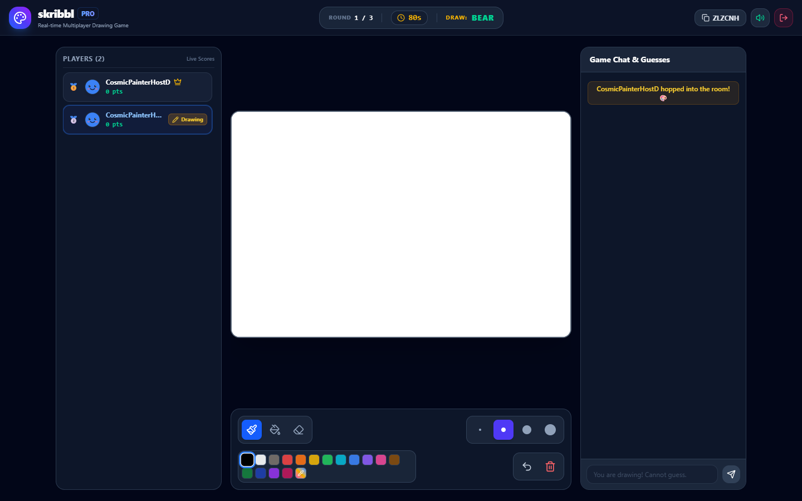
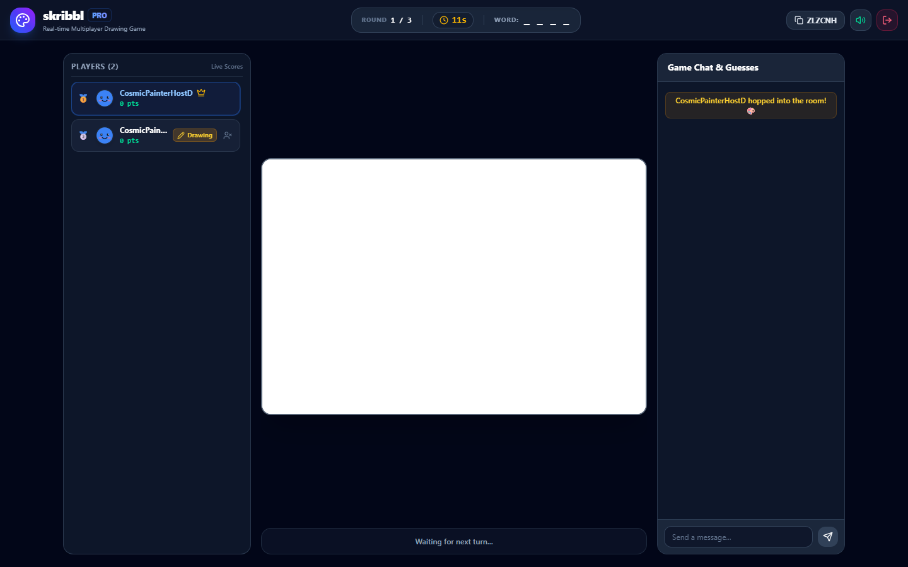
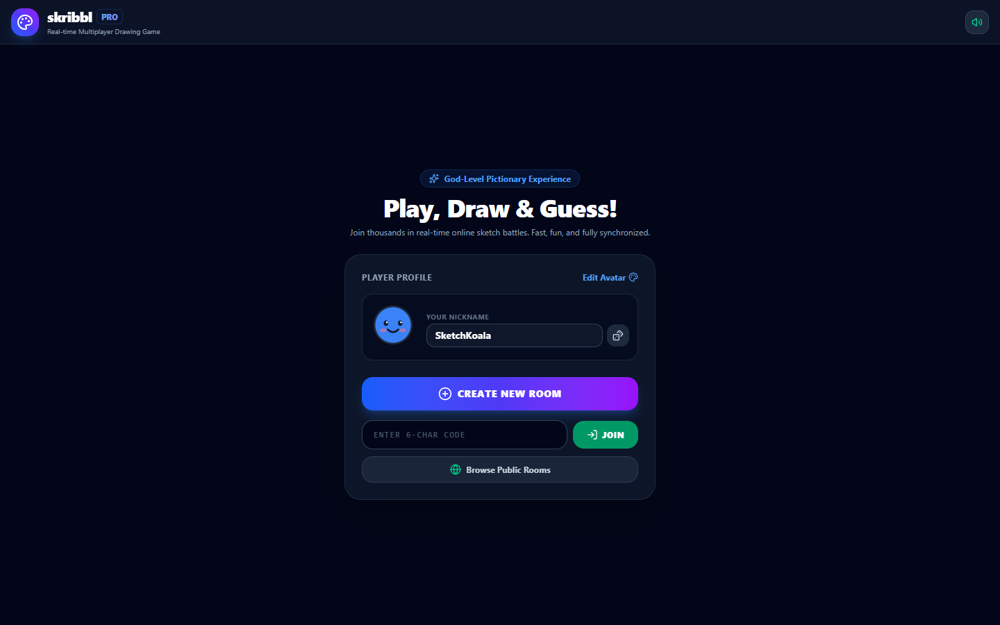
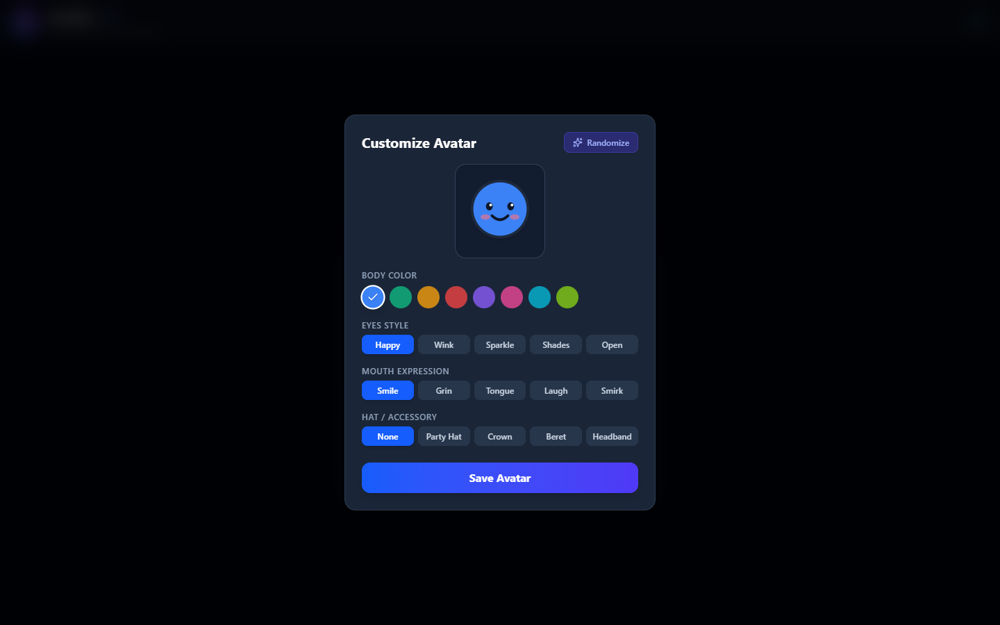
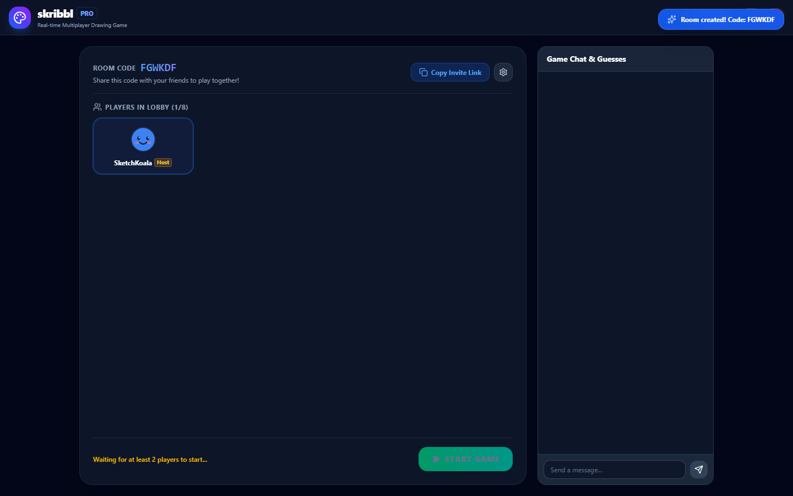
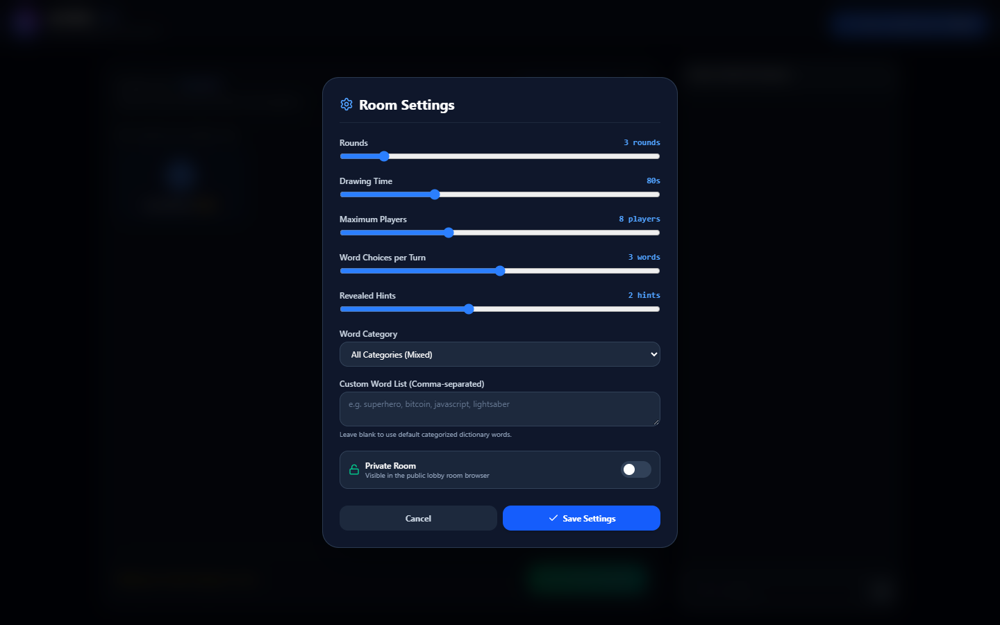
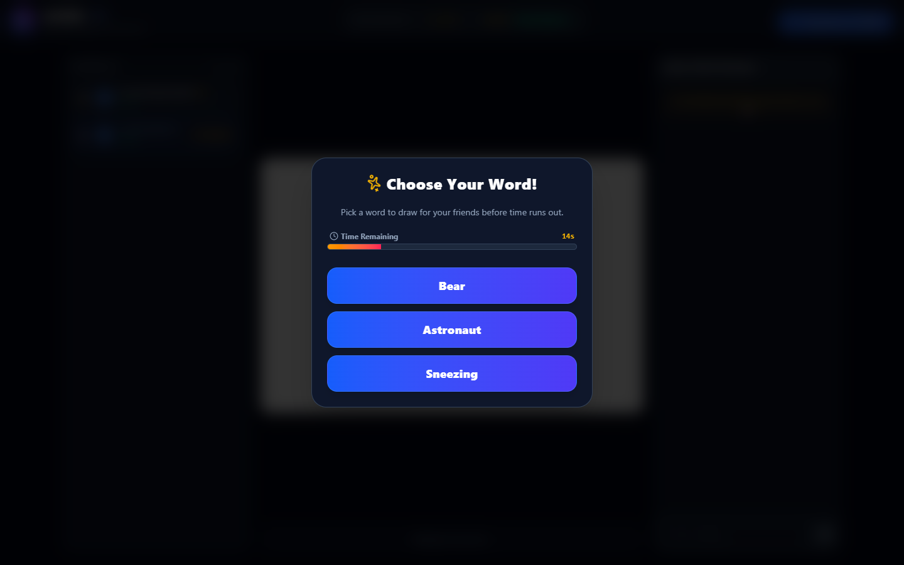
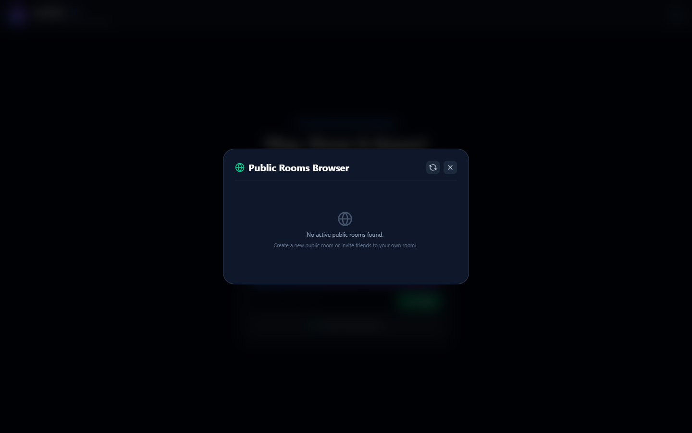

# 🎨 Skribbl.io Pro — God-Level Real-Time Multiplayer Drawing & Guessing Game

> A production-grade, end-to-end full-stack clone of [skribbl.io](https://skribbl.io) engineered with **Object-Oriented Programming (OOP)**, **Node.js + Express**, **Socket.IO**, **React 19 + TypeScript + Vite**, and **Tailwind CSS**.

---

### 🌐 Live Production Deployment
🚀 **Play Live Now:** **[https://skribblio-clone-pro.onrender.com/](https://skribblio-clone-pro.onrender.com/)**  
⚡ **Health Check Endpoint:** **[https://skribblio-clone-pro.onrender.com/health](https://skribblio-clone-pro.onrender.com/health)**  
*(Real-time multiplayer drawing, flood fill, progressive hint engine, procedural avatars, and live sound effects)*

---

## 🌟 Highlights & God-Level Capabilities

- 🎯 **Full OOP WebSocket Architecture**: Modular encapsulation across `Room`, `Game`, `Player`, `WordManager`, `DrawingSession`, and `RoomManager` classes.
- 🖌️ **Responsive Normalized Canvas**: Strokes and brush movements are recorded in a normalized `[0.0, 1.0]` coordinate space, rendering identically across phones, tablets, and 4K displays.
- 🪣 **BFS Paint Bucket (Flood Fill)**: True pixel-level flood fill algorithm synchronized over WebSockets.
- ⏪ **Vector Undo & Round Drawing Replay**: Canvas operations are logged as immutable vector actions, enabling instant undo and high-speed drawing replays at round end.
- 🎭 **Interactive Procedural Avatars**: Customizable SVG avatars with custom body colors, eye expressions, mouths, and accessories.
- 💡 **Progressive Hint Engine**: Server-driven progressive hint reveals (e.g., `_ _ A _ _ _`) at calculated round intervals without spoiling answers.
- 🔍 **Fuzzy Guess Matching (Levenshtein Distance)**: Detects near-miss typos (e.g. *"elepant"* for *"elephant"*) and privately alerts the guesser with *"You are very close!"*.
- 🏆 **Winner Podium & Particle Confetti**: Dynamic 1st, 2nd, and 3rd place podium with real-time celebrations and detailed score statistics.
- 🔊 **Synthesized Web Audio Engine**: Zero-asset audio synthesizer generating joyful chimes, drawing pops, countdown ticks, and victory fanfares directly in-browser.
- 🌐 **Dual Deployment Mode**: Runs as a **unified single-port full-stack application** (Express serving Vite frontend) or as an **independent frontend + backend split**.

---

## 📸 Application Previews & Screenshots

| 🎨 Active Gameplay (Drawer Tools & Canvas) | 👁️ Active Gameplay (Guesser View & Live Chat) |
| :---: | :---: |
|  |  |

| 🏠 Landing Page & Player Profile | 🎭 Procedural SVG Avatar Customizer |
| :---: | :---: |
|  |  |

| 👥 Multiplayer Room Lobby | ⚙️ Host Room Settings (Rounds, Hints, Rules) |
| :---: | :---: |
|  |  |

| 💡 Drawer Word Selection Modal | 🌐 Live Public Rooms Browser |
| :---: | :---: |
|  |  |

---

## 🏗️ System Architecture

```
                                  ┌──────────────────────────┐
                                  │   Browser Clients (xN)   │
                                  └─────────────┬────────────┘
                                                │
                                    WebSocket   │  HTTP (REST API & Static)
                                    (Socket.IO) │  /health, /api/rooms
                                                ▼
                     ┌─────────────────────────────────────────────────────┐
                     │          Node.js Express + Socket.IO Server         │
                     │  ┌───────────────────────────────────────────────┐  │
                     │  │                 socketHandler                 │  │
                     │  └───────────────────────┬───────────────────────┘  │
                     │                          │                          │
                     │  ┌───────────────────────▼───────────────────────┐  │
                     │  │                  RoomManager                  │  │
                     │  │    - Active Rooms Map & Socket-to-Room Index  │  │
                     │  └───────────────────────┬───────────────────────┘  │
                     │                          │                          │
                     │  ┌───────────────────────▼───────────────────────┐  │
                     │  │                   Room Model                  │  │
                     │  │  - Participant Map (Player Models)            │  │
                     │  │  - Host & Kick Moderation                     │  │
                     │  │  - Host Settings (Rounds, DrawTime, Hints...) │  │
                     │  └───────────────────────┬───────────────────────┘  │
                     │                          │                          │
                     │  ┌───────────────────────▼───────────────────────┐  │
                     │  │                   Game Model                  │  │
                     │  │  - State Machine (LOBBY/SELECT/DRAW/END/OVER) │  │
                     │  │  - Round Timers & Turn Rotation               │  │
                     │  │  - Dynamic Scoring & Drawer Bonus             │  │
                     │  └──────────┬─────────────────────────┬──────────┘  │
                     │             │                         │             │
                     │  ┌──────────▼──────────┐   ┌──────────▼──────────┐  │
                     │  │     DrawingSession  │   │     WordManager     │  │
                     │  │  - Vector Stroke Log│   │  - Categorized Bank │  │
                     │  │  - Undo / Replay    │   │  - Hint Generator   │  │
                     │  │  - Flood Fill Sync  │   │  - Levenshtein Eval │  │
                     │  └─────────────────────┘   └─────────────────────┘  │
                     └─────────────────────────────────────────────────────┘
```

---

## 📁 Repository Structure

```
skribbl-clone/
├── package.json               # Root scripts (dev, build, start, test)
├── README.md                  # Comprehensive technical documentation
├── server/                    # Backend Node.js + Express + Socket.IO (OOP)
│   ├── package.json
│   ├── test/
│   │   └── integration.test.js# Automated end-to-end integration test suite
│   └── src/
│       ├── index.js           # Server bootstrap & static client serving
│       ├── handlers/
│       │   └── socketHandler.js # Socket.IO event registry & dispatcher
│       ├── managers/
│       │   └── RoomManager.js # Central room & socket registry
│       ├── models/
│       │   ├── Player.js      # Player state, scores, and avatar model
│       │   ├── Room.js        # Room lifecycle, host migration & settings
│       │   ├── Game.js        # Core game loop, phases, timers & scoring
│       │   ├── DrawingSession.js # Vector canvas history, undo & replay
│       │   └── WordManager.js # Word banks, hint engine & Levenshtein eval
│       └── words/
│           └── wordBank.js    # Categorized dictionaries (animals, food, tech...)
└── client/                    # Frontend React 19 + TypeScript + Vite + Tailwind
    ├── package.json
    ├── vite.config.ts         # Vite configuration with Tailwind CSS v4 & proxy
    ├── index.html
    └── src/
        ├── App.tsx            # Main application controller & router
        ├── index.css          # Modern Tailwind styling & glow animations
        ├── types/
        │   └── game.ts        # Full TypeScript definitions & interfaces
        ├── lib/
        │   └── socket.ts      # Configured Socket.IO client instance
        ├── components/
        │   ├── Canvas.tsx     # High-DPI normalized canvas with live cursor
        │   ├── DrawingTools.tsx # Brush, Eraser, Flood Fill & Color palette
        │   ├── Chat.tsx       # Real-time chat & smart guess stream
        │   ├── Leaderboard.tsx# Live scores, drawer tag & host controls
        │   ├── AvatarDisplay.tsx # SVG procedural avatar renderer
        │   ├── AvatarCreatorModal.tsx # Interactive avatar visualizer
        │   ├── WordPickerModal.tsx    # 3-word selection with timer
        │   ├── RoundEndModal.tsx      # Target word reveal & drawing replay
        │   ├── GameOverModal.tsx      # Podium celebration & confetti
        │   ├── SettingsModal.tsx      # Host room configuration modal
        │   └── PublicRoomsModal.tsx   # Browse & 1-click join public rooms
        └── utils/
            ├── floodFill.ts      # Fast BFS queue-based canvas flood fill
            ├── canvasRenderer.ts # Vector stroke renderer & replay animator
            └── SoundManager.ts   # Synthesized Web Audio API sound engine
```

---

## ⚡ Feature Breakdown & Checklist

### 1. Must Have (100% Implemented)
- [x] **Create Room with Configurable Settings**: Host can adjust rounds (2-10), draw time (15-240s), max players (2-20), word choices (1-5), and hints (0-5).
- [x] **Join Room via Code or Direct Link**: Join using 6-character room code or automatic link parsing (`?room=XYZ`).
- [x] **Lobby with Player List**: Real-time roster with custom avatars, host badge, kick button, and start button.
- [x] **Turn-Based Rounds**: One drawer per turn, others guess; round-robin rotation with round counters.
- [x] **Real-Time Drawing Sync**: Vector strokes rendered smoothly across all connected viewers.
- [x] **Word Selection**: Drawer picks 1 of N words within a 15-second countdown.
- [x] **Guessing & Scoring**: Points calculated based on speed (`points = floor(timeRatio * 400) + 100`). Drawer earns bonus points per correct guess.
- [x] **Game End**: Winner podium screen with score medals and confetti celebration.
- [x] **Drawing Tools**: Brush, Eraser, 16 curated colors + color picker, 4 brush sizes, Undo, and Clear canvas.

### 2. Should Have (100% Implemented)
- [x] **Progressive Letter Hints**: Blanks (`_ _ _ _`) update with revealed letters over time at calculated intervals.
- [x] **Smart Chat**: Correct guesses are automatically hidden from chat so answers aren't spoiled; correct guessers get a private chat channel.
- [x] **Draw Time Countdown**: Live digital countdown with urgent red pulses and clock tick sound effects.
- [x] **Private & Public Rooms**: Toggle rooms as private (link-only) or public (listed in live room browser).

### 3. Nice to Have & God-Level Extras (100% Implemented)
- [x] **Paint Bucket Tool (Flood Fill)**: BFS algorithm allows 1-click filling of closed shapes, synchronized across WebSockets.
- [x] **Replay Round Drawing**: Watch the round's artwork get redrawn at 4x speed during the round transition screen.
- [x] **Levenshtein Distance Check**: Notifies players when they have a minor typo (`"elepant"` -> *"You are very close!"*).
- [x] **Custom Word Lists & Categories**: Host can choose categories (Animals, Food, Objects, Tech, Actions, Places) or input custom comma-separated words.
- [x] **Procedural SVG Avatars**: Players can configure body color, eyes, mouth expression, and hats/accessories.
- [x] **Host Moderation**: Host can kick disruptive players in lobby or mid-game.
- [x] **Host Migration**: If the room host leaves, ownership automatically migrates to the next player.
- [x] **Synthesized Sound Effects**: Built-in Web Audio API synthesizes pop, chime, alert, buzzer, and victory fanfare with zero external audio assets.

---

## 🔌 WebSocket Event Specification

| Event Name | Direction | Payload | Description |
| :--- | :--- | :--- | :--- |
| `create_room` | Client ➔ Server | `{ hostName, avatar, settings }` | Creates a room and registers the host. |
| `join_room` | Client ➔ Server | `{ roomId, playerName, avatar }` | Joins an existing room by code. |
| `get_public_rooms` | Client ➔ Server | `{}` | Returns all active, joinable public rooms. |
| `player_joined` | Server ➔ Clients | `{ player, players }` | Broadcasts new player and updated player roster. |
| `player_left` | Server ➔ Clients | `{ playerId, playerName, players }` | Broadcasts player departure and updated roster. |
| `start_game` | Client ➔ Server | `{ roomId }` | Host starts the game session. |
| `round_start` | Server ➔ Clients | `{ drawerId, drawerName, round, totalRounds, drawTime }` | Initiates word selection phase. |
| `word_choices` | Server ➔ Drawer | `{ words, timeLimit }` | Privately delivers random words to drawer. |
| `choose_word` | Client ➔ Server | `{ roomId, word }` | Drawer selects their chosen word. |
| `word_chosen` | Server ➔ Clients | `{ drawerId, maskedWord, wordLength, drawTime }` | Starts drawing timer and shows masked blanks. |
| `your_word` | Server ➔ Drawer | `{ word }` | Privately reveals target word to the drawer. |
| `timer_tick` | Server ➔ Clients | `{ timeLeft }` | Real-time 1-second countdown sync. |
| `hint_update` | Server ➔ Clients | `{ maskedWord }` | Broadcasts newly revealed letter hint. |
| `draw_stroke` | Client ➔ Server | `{ roomId, action }` | Drawer submits brush stroke or flood fill. |
| `draw_data` | Server ➔ Clients | `{ type, points, color, size, x, y }` | Broadcasts stroke action to other players. |
| `draw_cursor` | Client ➔ Server | `{ roomId, x, y }` | Drawer emits normalized mouse cursor location. |
| `drawer_cursor`| Server ➔ Clients | `{ x, y }` | Broadcasts drawer's brush pointer to guessers. |
| `draw_undo` | Client ➔ Server | `{ roomId }` | Drawer undoes last vector stroke. |
| `canvas_clear` | Client ➔ Server | `{ roomId }` | Clears canvas for all room participants. |
| `chat_or_guess`| Client ➔ Server | `{ roomId, text }` | Submits guess or chat text. |
| `guess_result` | Server ➔ Clients | `{ correct, playerId, playerName, points, scores }` | Broadcasts correct guess & updated scores. |
| `close_guess` | Server ➔ Guesser | `{ text }` | Privately alerts guesser that their typo is close. |
| `chat_message` | Server ➔ Clients | `{ playerId, playerName, avatar, text, type }` | Broadcasts general or post-guess chat. |
| `round_end` | Server ➔ Clients | `{ word, scores, leaderboard, nextDrawer, replayData }` | Reveals word, awards scores & offers replay. |
| `game_over` | Server ➔ Clients | `{ leaderboard, winner, totalRounds }` | Concludes match and displays podium celebration. |
| `kick_player` | Client ➔ Server | `{ roomId, targetPlayerId }` | Host removes a player from the session. |
| `return_to_lobby`| Client ➔ Server| `{ roomId }` | Host resets match and returns all to lobby. |

---

## 🚀 Running Locally

### Prerequisites
- **Node.js** (v18.0.0 or higher)
- **npm** (v9.0.0 or higher)

### 1-Command Startup
In the root directory, run:
```bash
# 1. Install root, backend, and frontend dependencies
npm run dev
```
- Frontend will be available at: `http://localhost:3000`
- Backend WebSocket server will be available at: `http://localhost:4000`
- Vite automatically proxies `/socket.io` and `/api` requests to port 4000!

### Production Single-Port Build & Run
To test the production build served entirely by the Express backend:
```bash
# 1. Build the frontend
npm run build

# 2. Start the unified production server
npm start
```
Open **`http://localhost:4000`** in your browser.

### Running Integration Tests
To verify all game logic, hint algorithms, scoring, and OOP models:
```bash
npm test
```

---

## 🌐 Deployment & Live Access

### 🚀 Verified Live Deployment
* **Live Web App**: [https://skribblio-clone-pro.onrender.com/](https://skribblio-clone-pro.onrender.com/)
* **System Status & Healthcheck**: [https://skribblio-clone-pro.onrender.com/health](https://skribblio-clone-pro.onrender.com/health)

This project is built to deploy easily to all major cloud platforms.

### Option A: 1-Click Unified Full-Stack on Render / Railway (Recommended)
Because our Express server serves the static Vite frontend in production, you only need to deploy **one single service**!

#### Render Deployment Steps:
1. Create a new **Web Service** on [Render](https://render.com).
2. Connect your repository.
3. Configure settings:
   - **Environment**: `Node`
   - **Build Command**: `npm run build`
   - **Start Command**: `npm start`
4. Set Environment Variables:
   - `PORT`: `4000` (or leave default assigned by Render)
5. Deploy! Your app will be live at `https://your-service-name.onrender.com`.

### Option B: Split Deployment (Vercel Frontend + Render Backend)
- **Backend (Render / Railway)**:
  - Root directory: `server`
  - Start command: `node src/index.js`
  - WebSocket support is enabled out-of-the-box.
- **Frontend (Vercel / Netlify)**:
  - Root directory: `client`
  - Build command: `npm run build`
  - Output directory: `dist`
  - Environment variable: `VITE_BACKEND_URL=https://your-backend.onrender.com`

---

## 💡 Code Understanding & Explanations

### 1. How drawing strokes are captured, sent, and rendered across clients
When the drawer draws on the `<canvas>`:
1. Touch or mouse positions are captured and converted into **normalized coordinates** (`x / rect.width`, `y / rect.height`) in the range `0.0` to `1.0`.
2. As the stroke continues, points are batched and emitted via `draw_stroke`.
3. The server validates that the emitter is indeed the `activeDrawerId` and in the `DRAWING` phase, stores the vector stroke in `DrawingSession`, and broadcasts it using `socket.to(roomId).emit('draw_data', action)`.
4. Other connected clients receive the normalized coordinates and map them to their local canvas dimensions (`x * localWidth`, `y * localHeight`), guaranteeing identical rendering across all devices and screen resolutions.

### 2. How game state (rounds, turn order, scoring) is managed
- Encapsulated within the `Game` class.
- When started, `buildDrawerOrder()` creates a shuffled array of participant IDs.
- A state machine tracks transitions: `LOBBY` ➔ `WORD_SELECTION` (15s timer) ➔ `DRAWING` (configurable draw timer) ➔ `ROUND_END` (5s transition) ➔ `GAME_OVER`.
- Scoring uses a decay curve based on remaining time:
  $$\text{Points} = \left\lfloor \frac{\text{TimeLeft}}{\text{DrawDuration}} \times 400 \right\rfloor + 100$$
- In addition, the drawer receives $+75$ points for every player who correctly guesses their drawing, incentivizing accurate and recognizable artwork.

### 3. Word-matching logic (Case, Trim, Partial / Levenshtein)
- When a guess arrives via `chat_or_guess`, it is trimmed and converted to lowercase.
- **Exact Match**: If it matches the target word, the player is awarded points, the word is withheld from the general chat to prevent spoiling, and a green broadcast notification is sent.
- **Levenshtein Distance**: If the edit distance is $\le 2$ on words with $\ge 4$ characters (e.g. `"butterfli"` for `"butterfly"`), a private alert *"You are very close!"* is delivered exclusively to that player.

### 4. WebSocket constraints & why Render/Railway are ideal
- Standard serverless platforms like Vercel and Netlify use short-lived HTTP lambda functions that terminate after requests, making persistent WebSocket connections unfeasible without third-party services.
- Platforms like **Render** and **Railway** run long-lived Node.js processes that natively support persistent WebSocket connections, ping/pong heartbeats, and low-latency drawing synchronization.

---

## 🏆 Summary Checklist vs Assignment Requirements

| Requirement | Assignment PDF Spec | Our Implementation |
| :--- | :--- | :--- |
| **Multiplayer Rooms** | Public & private rooms, join via link/code | ✅ 6-char code, direct link parsing, live public browser |
| **Turn-based Drawing** | One drawer per round, round rotation | ✅ Round-robin queue, auto-skips on disconnect |
| **Real-time Sync** | WebSockets sync canvas, chat, game state | ✅ Socket.IO real-time sync with vector history |
| **Word System** | 1-5 word choices, blanks & letter hints | ✅ Dynamic word picker, progressive hint algorithm |
| **Scoring** | Points for correct guess, leaderboard, winner | ✅ Speed-based points, drawer reward, podium & confetti |
| **Drawing Tools** | Brush, colors, eraser, undo, clear | ✅ 16 colors + custom picker, 4 sizes, BFS flood fill |
| **OOP Architecture** | Room, Game, Player, Manager classes | ✅ Clean OOP domain models and separation of concerns |
| **Bonus Features** | Custom words, avatars, replay, kick/ban | ✅ All bonus features fully implemented |
